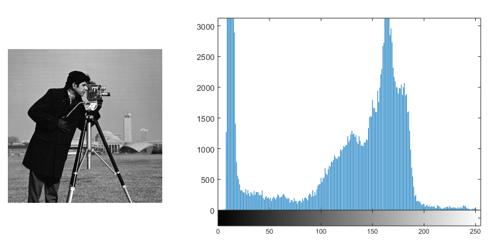
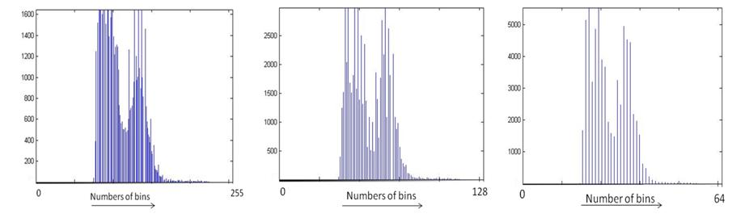

An image histogram represents the distribution of pixel intensities in an image. It provides statistical information about how frequently different intensity values occur. Histograms are useful in image processing applications such as image enhancement, image analysis, compression, and segmentation.

For a grayscale image, the histogram shows the number of pixels having each possible gray-level value. By studying the shape and distribution of a histogram, useful information about the brightness, contrast, and intensity distribution of an image can be obtained.

In the **Image Histogram experiment**, you will study how the pixel intensities of an image are distributed, how the number of histogram bins affects the appearance of the histogram, and how histogram information can be used for image enhancement.

### Image Histogram

Let (A) represent a grayscale image. The histogram (H(k)) is obtained by counting the number of pixels having gray-level value (k).

$$
H(k)=N_k
$$

where (N_k) is the number of pixels having gray-level value (k).

If the image contains (K) possible gray levels, then

$$
k=0,1,2,\ldots,K-1
$$

and the histogram contains (K) bins.

For an (M)-bit grayscale image, the maximum number of distinct intensity values is

$$
2^M
$$

Therefore, when every possible intensity value is represented by a separate bin,

$$
K=2^M
$$

For an 8-bit grayscale image,

$$
K=2^8=256
$$

and the gray-level values range from

$$
0\leq k\leq255
$$

For a binary image with one bit per pixel, there are only two possible intensity values, so the histogram contains two bins.

The total number of pixels in the image is equal to the sum of all histogram counts:

$$
\sum_{k=0}^{K-1}H(k)=N
$$

where (N) is the total number of pixels in the image.

_Figure: A grayscale image and its corresponding intensity histogram._

The figure illustrates the relationship between an image and its histogram. The horizontal axis of the histogram represents the gray-level value, while the vertical axis represents the number of pixels having that gray-level value. A peak in the histogram indicates that the corresponding intensity occurs frequently in the image, whereas a region with few or no pixels indicates that those intensity values occur less frequently.

A histogram represents the distribution of pixel intensities but does not contain information about their spatial locations. Therefore, two images can have similar histograms even when the objects and their spatial arrangements in the images are different.

### Histogram Bins

A histogram bin represents a category or range of pixel intensity values. When every possible gray level is assigned to a separate bin, each bin corresponds to one gray-level value.

The number of bins does not always have to be equal to the maximum number of possible gray levels. A smaller number of bins can be used by grouping neighbouring intensity values into the same bin.

For an (M)-bit image, the maximum number of distinct intensity values is

$$
2^M
$$

However, the number of histogram bins can be selected to be smaller than this maximum.

_Figure: Effect of changing the number of histogram bins._

The figure shows how changing the number of bins changes the appearance and level of detail of a histogram. A larger number of bins provides a more detailed representation of the intensity distribution, while a smaller number of bins groups intensity values together and produces a more compact representation.

Therefore, changing the number of bins changes how the intensity distribution is represented in the histogram, even though the underlying image remains unchanged.

### Normalized Histogram

A histogram can also be represented in normalized form. Instead of showing the absolute number of pixels at each gray level, a normalized histogram represents the proportion of pixels corresponding to each gray level.

If (N) is the total number of pixels in the image, the normalized histogram is given by

$$
p(k)=\frac{H(k)}{N}
$$

where (p(k)) represents the proportion of pixels having gray-level value (k).

The sum of all normalized histogram values is

$$
\sum_{k=0}^{K-1}p(k)=1
$$

The normalized histogram is useful for describing the relative distribution of pixel intensities.

### Histogram and Image Appearance

The distribution of gray levels in a histogram provides useful information about the visual appearance of a grayscale image.

A **dark image** generally has most of its pixels concentrated toward the lower gray levels. Its histogram is therefore concentrated toward the lower-intensity side of the available range.

A **bright image** generally has most of its pixels concentrated toward the higher gray levels. Its histogram is therefore concentrated toward the higher-intensity side.

An image with **poor contrast** generally has pixel values concentrated within a relatively narrow portion of the available gray-level range.

An image with **high contrast** generally has pixel values distributed over a wider portion of the available gray-level range.

Thus, the histogram provides a useful indication of the brightness and contrast characteristics of an image.

### Image Statistics from the Histogram

The histogram can also be used to obtain statistical information about an image. Examples include the mean intensity, median intensity, standard deviation, and the number of prominent modes.

The mean intensity provides an indication of the average brightness of the image. For a normalized histogram, it can be expressed as

$$
\mu=\sum_{k=0}^{K-1}k,p(k)
$$

where (\mu) is the mean gray-level value.

The spread of the intensity distribution provides information about the variation in pixel values. A greater spread generally indicates greater variation in the intensities of the image.

A **mode** corresponds to a gray-level value or intensity range that occurs frequently and therefore appears as a prominent peak in the histogram. An image may have one dominant peak or several peaks depending on its intensity distribution.

These statistical properties can be useful for analysing the intensity characteristics of an image and for selecting appropriate image processing operations.

### Histogram Processing

The histogram of an image can be used not only to analyse the image but also to modify its appearance. Histogram processing refers to image enhancement techniques that manipulate the distribution of pixel intensities.

One important histogram processing technique is **histogram equalization**.

### Histogram Equalization

Histogram equalization is an image enhancement technique used to redistribute gray levels over the available intensity range. It can improve the visual contrast of an image, particularly when the original intensity values occupy only a limited portion of the available range.

Let (p(k)) represent the normalized histogram of an image. The cumulative distribution function is given by

$$
C(k)=\sum_{j=0}^{k}p(j)
$$

For an image with (K) possible gray levels, a commonly used histogram equalization transformation is

$$
s(k)=(K-1)C(k)
$$

where (s(k)) is the transformed gray-level value.

The transformation maps the original gray levels to new gray levels according to the cumulative distribution of the histogram. This redistributes the intensity values over a wider portion of the available gray-level range.

The purpose of histogram equalization is not necessarily to make every histogram bin contain exactly the same number of pixels. Instead, it attempts to produce a more evenly distributed intensity range and thereby improve the contrast of the image.

### Global and Local Histogram Equalization

Histogram equalization can be performed using information from the entire image or from smaller regions of the image.

In **global histogram equalization**, the histogram of the entire image is used to determine the intensity transformation. The resulting transformation is therefore based on the overall intensity distribution of the image.

In **local histogram equalization**, the image is divided into smaller regions and histogram processing is performed separately for those regions. This allows the enhancement to adapt to the intensity distribution of each local region.

When histogram equalization is applied locally, the procedure is commonly referred to as **Adaptive Histogram Equalization**.

Global and local histogram equalization can produce different results because they use different portions of the image to determine the intensity transformation.

### What to Observe in the Image Histogram Experiment

In this experiment, observe how the histogram represents the distribution of pixel intensities in the input image.

In particular, observe:

- how the horizontal axis represents gray-level values and the vertical axis represents the number of pixels;
- how the concentration of histogram values relates to the brightness of an image;
- how the spread of histogram values relates to the contrast of an image;
- how changing the number of histogram bins changes the appearance of the histogram;
- how histogram statistics provide information about the intensity distribution; and
- how histogram equalization changes the distribution of pixel intensities and affects the visual contrast of the image.

These observations help establish the relationship between the intensity distribution of an image and the information represented by its histogram.

### Understanding Image Histograms

An image histogram provides a compact representation of how pixel intensities are distributed within an image. It can be used to understand the brightness and contrast characteristics of an image and to obtain useful statistical information about its pixel values.

The histogram can also be used as a basis for image enhancement. Histogram equalization uses the intensity distribution to transform pixel values and improve the utilization of the available gray-level range.

The key idea of the **Image Histogram experiment** is that the distribution of pixel intensities provides useful information about an image. By examining and processing this distribution, the brightness, contrast, and intensity characteristics of an image can be analysed and, where appropriate, enhanced.
